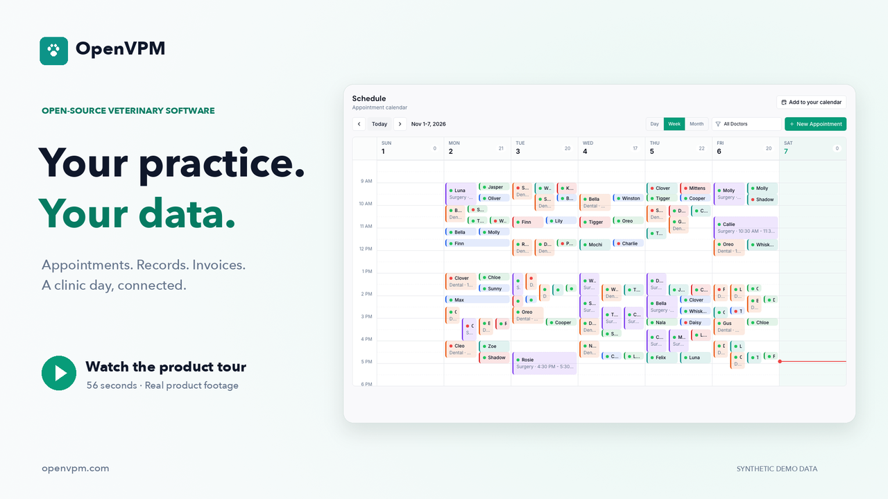
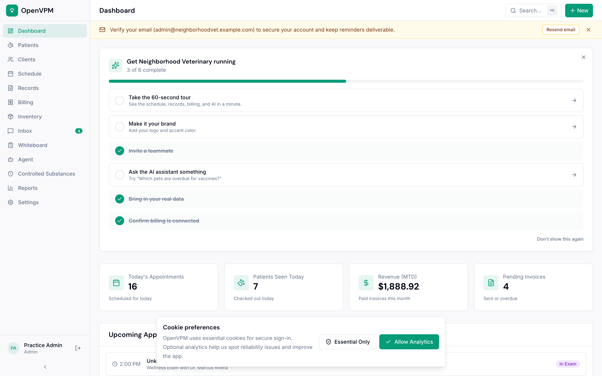
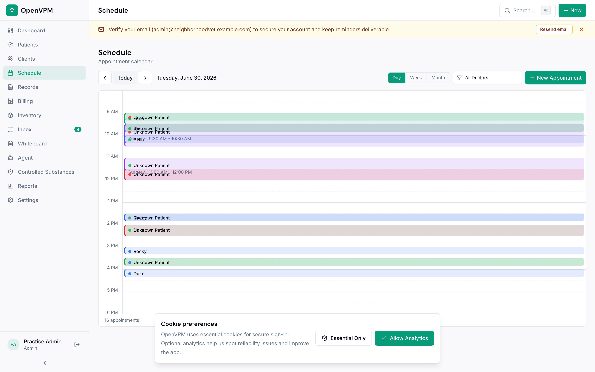
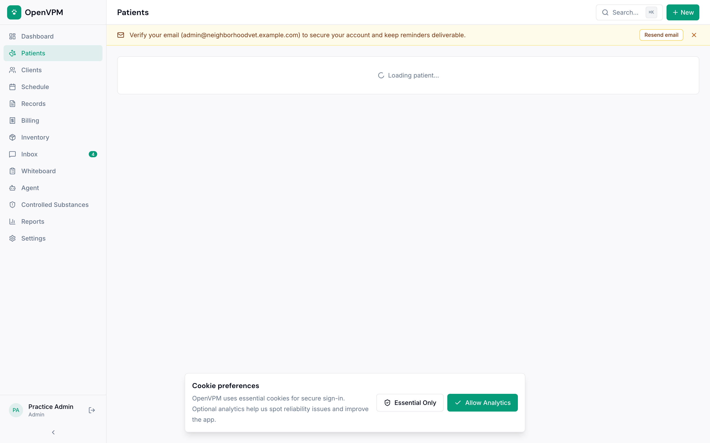

<p align="center">
  
</p>

<h1 align="center">OpenVPM</h1>

<p align="center">
  <strong>Open-source veterinary software. Your practice. Your data.</strong>
</p>

<p align="center">
  <a href="https://demo.openvpm.com/login">Live Demo</a> &middot;
  <a href="https://openvpm.com">Website</a> &middot;
  <a href="https://docs.openvpm.com">Guides</a> &middot;
  <a href="#features">Features</a> &middot;
  <a href="#quick-start">Quick Start</a> &middot;
  <a href="#api">API Docs</a> &middot;
  <a href="#roadmap">Roadmap</a> &middot;
  <a href="#contributing">Contributing</a>
</p>

<p align="center">
  <a href="https://github.com/evangauer/openvpm/actions"></a>
  <a href="LICENSE"></a>
  <a href="CONTRIBUTING.md"></a>
  <a href="https://github.com/evangauer/openvpm/discussions"></a>
  <a href="https://github.com/evangauer/openvpm/stargazers"></a>
</p>

<p align="center">
  <strong>Veterinary software should belong to the people who use it.</strong>
</p>

OpenVPM brings appointments, patient records, clinical notes, and billing into one workspace. Explore the demo, run it on your own infrastructure, or build on the API.

<p align="center">
  <a href="https://docs.openvpm.com/media/openvpm-product-tour-v1.mp4">
    
  </a>
</p>

<p align="center">
  <a href="https://docs.openvpm.com/media/openvpm-product-tour-v1.mp4"><strong>Watch the 56-second product tour</strong></a> &middot;
  <a href="https://demo.openvpm.com/login"><strong>Try the live demo</strong></a> &middot;
  <a href="docs/api/README.md">Build with the API</a>
</p>

<p align="center">
  <sub>Real product footage with fictional demo data. The API segment illustrates documented interfaces. <a href="docs/media/product-tour.en.srt">English captions</a> · <a href="docs/clinic-pilot-readiness.md">Clinic pilot readiness guide</a>.</sub>
</p>

<p align="center">
  If you want veterinary software to be open, <strong><a href="https://github.com/evangauer/openvpm">star OpenVPM</a></strong> to help clinics and builders find it.
</p>

---

## What is OpenVPM?

OpenVPM is a modern, cloud-native veterinary practice information management system that is:

- **Beautiful and intuitive** — Practice managers and front desk staff should be productive within a single shift, not a multi-week training program
- **API-first** — Dashboard workflows use typed tRPC procedures, while external integrations use scoped `/api/v1` REST endpoints and signed webhooks for supported read/write workflows
- **Cloud-native but self-hostable** — Run it on our cloud or deploy it on your own infrastructure
- **Free and open source** — AGPLv3, forever. No per-provider pricing. No vendor lock-in. Your data is yours.

> _"I was intrigued and excited to find that there is a viable open-source practice management offering out there."_
> — Veterinarian and veterinary software builder

## Screenshots

<p align="center">
  
</p>

<p align="center">
  
  
</p>

<p align="center"><sub>Current application UI rendered from the repository's seeded demo practice. The reproducible capture flow lives in <a href="e2e/demo-screenshots.spec.ts">e2e/demo-screenshots.spec.ts</a>.</sub></p>

## Help & Guides

[OpenVPM Help](https://docs.openvpm.com) has step-by-step guides with real screens for the front desk, clinical team, and practice managers, a tour of every screen, and a training path for each role. The site lives in [apps/docs](apps/docs), and its screenshots are captured from the seeded demo clinic ([how](apps/docs/capture/README.md)). Self-hosting setup guides stay in [docs/help](docs/help/README.md). Before evaluating OpenVPM for live clinic use, read the [Clinic Pilot Readiness Guide](docs/clinic-pilot-readiness.md) for the current supported, configuration-dependent, and not-yet-supported boundaries. Switching from another PIMS? Start with [Migrating to OpenVPM](docs/migrating-to-openvpm.md).

## Features

### Phase 1 — Foundation (Implemented)

**Patient & Client Management**
Complete patient records with species, breed, weight history with trend charts, microchip tracking, photo uploads, and allergy/reaction alerts. Multi-pet households linked to single clients. Instant fuzzy search across all records via Cmd+K.

**Appointment Scheduling**
Visual calendar with day/week views and column-per-doctor layout. Configurable appointment types with durations and colors. Doctor-specific vs. any-doctor scheduling, with doctor and room conflict detection. Full status flow: Scheduled > Checked In > In Exam > Checked Out. Recurring appointments and block scheduling.

**Electronic Medical Records (EMR)**
SOAP notes with rich text editing. Problem lists (active/resolved/chronic). Vaccination records with reminders and certificate generation. Lab results viewer with reference ranges and trend graphs. Prescription management with dosing calculator and refill tracking. Document and image attachments.

**Billing & Invoicing**
Structured visit closeout keeps the clinical handoff, follow-up plan, invoice or no-charge disposition, and checkout connected. Treatment templates can populate draft invoices, with itemized manual service/product line items, tax calculation, estimates that convert to invoices, payment tracking, account balances, and revenue reporting.

**Inventory Management**
Product catalog with stock levels, reorder point alerts, lot/batch tracking, and expiration dates. Auto-deduction when products are dispensed from invoices or EMR prescriptions. Supplier contact management for reorder workflows.

**Controlled Substance Tracking**
Controlled-substance logging with patient and lot linkage, running balances,
waste-witness fields, and full audit trails. Practices should validate the
configured workflow against their federal, state, and local procedures.

### Phase 2 — Communication & Intelligence (Core implemented; delivery services require configuration)

**Client Communication Hub**
Communication history across calls, texts, emails, and inbound portal requests. Appointment and vaccination reminder workflows are administrator-controlled, and email delivery requires a configured provider. Hosted SMS and two-way texting are a controlled, one-location clinic pilot that requires carrier activation and recorded client consent. General-purpose bulk marketing campaigns are not included.

**Practice Whiteboard**
Shared, auto-refreshing patient status board showing patient name, doctor, room, status, time in, procedure, and notes across clinic workflows.

**Reporting & Analytics**
Dashboard with KPI cards, revenue trends, appointment utilization, species distribution, and production by doctor. Exportable to CSV/PDF.

**Client Portal**
Pet owners can view health records, request appointments, download vaccination certificates, view invoices, pay online when Stripe checkout is configured, and see active prescriptions.

### Phase 3 — API & AI (Implemented; AI requires a configured model provider)

**Open API**
Versioned `/api/v1` REST API for external integrations, with API reference documentation. Webhook system for real-time events (appointment created, patient checked in, invoice paid). API key management with scopes and rate limiting. Audit logging.

**AI-Ready Architecture**
Structured data models queryable by AI agents. Signed webhook events for agent subscriptions. Integration points for SOAP note generation, appointment booking, checked-in appointment events, and hosted agent runs.

## Tech Stack

| Layer            | Technology                                                         |
| ---------------- | ------------------------------------------------------------------ |
| **Frontend**     | Next.js 15 (App Router), TypeScript, React 19                      |
| **UI**           | shadcn/ui + Radix UI + Tailwind CSS                                |
| **API**          | tRPC dashboard API + versioned `/api/v1` REST                      |
| **Database**     | PostgreSQL 16 + Drizzle ORM                                        |
| **Auth**         | NextAuth.js, role-based access, optional TOTP MFA, recovery codes  |
| **Events**       | Signed webhook delivery for integrations                           |
| **Email/SMS**    | Resend + Telnyx SMS (Twilio fallback)                              |
| **Payments**     | Stripe                                                             |
| **File Storage** | S3-compatible or Vercel Blob (PGSTY Silo for self-hosted)               |
| **Monorepo**     | Turborepo + pnpm workspaces                                        |
| **Testing**      | Vitest + Playwright                                                |
| **Deployment**   | Docker Compose (self-host) or Vercel (cloud)                       |

## Architecture

```
openvpm/
├── apps/
│   ├── web/                    # Next.js frontend + API
│   │   ├── app/                # App Router pages
│   │   │   ├── (auth)/         # Login, register
│   │   │   ├── (dashboard)/    # Main clinic workflows
│   │   │   └── portal/         # Client-facing portal
│   │   ├── components/         # UI component library
│   │   ├── lib/                # Utilities and integrations
│   │   └── server/             # tRPC routers and server services
│   └── docs/                   # Searchable Next.js staff-guide site
├── docs/                        # Help, API, deployment, and safety guides
├── packages/
│   ├── db/                     # Modular schema, migrations, RLS, seed data
│   ├── api/                    # Shared Zod validators
│   ├── config/                 # TypeScript, Tailwind config
│   ├── docs-content/           # Shared guide content and metadata
│   └── email/                  # Email templates
├── docker/                     # Docker Compose (PostgreSQL + MinIO)
└── e2e/                        # Playwright E2E tests
```

### Database Design

Modular schemas cover core clinical, scheduling, billing, inventory, communication, consent, migration, and operational records. Clinic-owned rows use explicit practice relationships and are protected by tenant-scoped application access plus database row-level security policies. Structured relational records are used for the primary clinic entities; JSON fields are reserved for bounded settings, event payloads, and immutable snapshots where their shape is explicitly managed.

### API Coverage

Dashboard tRPC routers cover the product's clinic workflows, including patients, clients, appointments, encounters, records, billing, inventory, communications, reporting, portal access, settings, and administration. Dashboard procedures include Zod validation and role-based access control through tRPC. External integrations use the smaller, scoped, API-key authenticated `/api/v1` REST surface documented below; dashboard router coverage does not imply equivalent public REST coverage.

### Security

- **Multi-tenancy:** Tenant-scoped application queries plus database row-level security for clinic-owned data
- **RBAC:** Admin, Veterinarian, Technician, Front Desk, and read-only Viewer roles enforced at the API layer
- **Auth:** NextAuth.js with bcrypt password hashing, database sessions, optional TOTP MFA, recovery codes, and privileged-action confirmation
- **Headers:** CSP, HSTS, Permissions-Policy, X-Content-Type-Options, X-Frame-Options, X-XSS-Protection, Referrer-Policy
- **Audit:** Audit records for security-sensitive and high-risk clinical and financial workflows; coverage is expanded as workflows mature

## Quick Start

### Prerequisites

- Node.js 24.22.1 or a newer Node.js 24 patch (`nvm use`)
- pnpm 9+
- Docker (for PostgreSQL and MinIO)

### Setup

```bash
# Clone the repository
git clone https://github.com/evangauer/openvpm.git
cd openvpm

# Copy environment config
cp .env.example .env

# Replace the placeholder NEXTAUTH_SECRET in .env with a generated one
# (or paste the output of `openssl rand -base64 32` into .env yourself)
sed -i.bak "s|^NEXTAUTH_SECRET=.*|NEXTAUTH_SECRET=\"$(openssl rand -base64 32)\"|" .env && rm .env.bak

# Start the local PostgreSQL and S3-compatible storage dependencies
docker compose --env-file .env -f docker/docker-compose.yml up -d postgres minio minio-bootstrap

# Install dependencies
pnpm install --frozen-lockfile

# Verify this clone contains only public release material
pnpm verify:oss-release

# Apply the committed database migrations
pnpm db:migrate

# Apply and verify row-level security policies
OPENPIMS_APP_DB_PASSWORD='local-openpims-app' pnpm db:rls
OPENPIMS_APP_DB_PASSWORD='local-openpims-app' pnpm db:rls:test

# Seed with realistic demo data
pnpm db:seed

# Start the development server
pnpm dev
```

Keep `.env` at the repository root beside `.env.example`. `pnpm dev` loads it
for the web server in `apps/web`; you do not need a second env file there.
Existing shell exports and app env values take precedence. If `DATABASE_URL`
is missing, the dev server stops with setup instructions. Restart `pnpm dev`
after changing the root env file. Production continues to use its deployment
environment.

Open [http://localhost:3000](http://localhost:3000) and sign in with the demo credentials:

| Role         | Email                                     | Password    |
| ------------ | ----------------------------------------- | ----------- |
| Admin        | admin@neighborhoodvet.example.com         | password123 |
| Veterinarian | sarah.chen@neighborhoodvet.example.com    | password123 |
| Technician   | jamie.torres@neighborhoodvet.example.com  | password123 |
| Front Desk   | morgan.bailey@neighborhoodvet.example.com | password123 |

The seed data creates a complete demo practice — "Neighborhood Veterinary" — with 8 staff, 25 clients, 40 patients, 2 weeks of appointments, SOAP notes, vaccination records, invoices, and 50 inventory products.

The Docker Compose stack uses [PGSTY Silo](https://github.com/pgsty/silo), a maintained MinIO-compatible server, pinned to a release and image digest for both AMD64 and ARM64 hosts. Its bundled `mcli` client creates the `openpims` bucket used by `S3_BUCKET`; the bootstrap exits with an error if storage cannot be reached after 60 attempts. When using an external S3-compatible store, create that bucket yourself and grant the app credentials read/write/delete/head access before uploads, backups, or file previews run.

The Compose service name `minio`, volume name `minio_data`, S3 endpoint, and `MINIO_*` settings remain compatible with existing configuration. Before upgrading an existing MinIO installation, keep an independent backup and follow the [Silo migration guide](https://silo.pgsty.com/compatibility/migration/). Do not delete the existing storage volume to upgrade.

Before using a self-hosted installation with real clinic data, complete the
[open-source release checklist](docs/open-source-release-checklist.md) and the
[clinic pilot readiness guide](docs/clinic-pilot-readiness.md). A successful
local build is not, by itself, a production-readiness assessment.

### Deploy with Docker

Allocate at least 4 GiB of memory to the Docker builder. The image build gives
Node a 3 GiB heap for compilation and type checking; the running application
keeps Node's default memory settings. On a larger builder, the heap can be
adjusted with `--build-arg BUILD_NODE_OPTIONS=--max-old-space-size=4096`.

```bash
# One time: create .env with a unique session secret
cp .env.example .env
sed -i.bak "s|^NEXTAUTH_SECRET=.*|NEXTAUTH_SECRET=\"$(openssl rand -base64 32)\"|" .env && rm .env.bak

docker compose --env-file .env -f docker/docker-compose.yml up -d
```

`NEXTAUTH_SECRET` signs every staff session, so it must be unique to your
installation. Compose refuses to start the app without it, and a production
build refuses to sign anyone in while it is a placeholder published in this
repository or shorter than 32 characters: every page shows a setup notice, API
routes return `503`, and `/api/health` reports the `authSecret` check as
failing. PostgreSQL and MinIO are published on `127.0.0.1` only; their default
credentials are for this single-host setup and must not be exposed to a network.

> **Upgrading an existing Docker install:** earlier versions of
> `docker/docker-compose.yml` shipped a fixed `NEXTAUTH_SECRET`. Anyone who knows
> that public value can forge a staff session on an install still using it.
> Generate a new secret as above, put it in `.env`, and restart with
> `docker compose --env-file .env -f docker/docker-compose.yml up -d`. Changing
> the secret signs everyone out once; staff sign in again with their usual
> password. Invoice payment links signed with the old secret also stop working
> and should be re-sent. Patient-portal sign-in links are not affected.
>
> The same upgrade binds PostgreSQL (`5432`) and the MinIO API and console
> (`9000`, `9001`) to `127.0.0.1` on the Docker host, so they are no longer
> reachable from other machines. If you administered them remotely, use an SSH
> tunnel instead, for example
> `ssh -N -L 5432:127.0.0.1:5432 -L 9001:127.0.0.1:9001 you@your-server`, then
> connect to `localhost:5432` or open `http://localhost:9001`.

The Docker setup includes PostgreSQL 16 with health checks, PGSTY Silo for S3-compatible file storage, automatic bucket bootstrap, and a multi-stage production build of the web application. For production, run `pnpm db:migrate`, then `OPENPIMS_APP_DB_PASSWORD='<strong>' pnpm db:rls`, verify with `OPENPIMS_APP_DB_PASSWORD='<same>' pnpm db:rls:test`, and point the app at the generated least-privilege `openpims_app` database role before serving traffic.

#### Reverse proxies and sign-in limits

Sign-in is limited per account: 5 free failures, then a lock that doubles from 1 minute up to 1 hour. That applies the same way whether or not the account exists, and it is the main defense against password guessing.

So that someone else's failed guesses can't keep staff out, each successful sign-in also sets a signed, HttpOnly "known device" cookie for 90 days. While an account is locked, a browser that has signed in to it before isn't held by that lock; it gets its own backoff (the same 5 failures, then 1 minute doubling to 1 hour). The correct password from a browser that has never signed in to the account still waits for the lock. Completing a password reset or accepting an invite proves control of the mailbox, so it lifts the account's lock and marks that browser as known too. One browser remembers up to 10 accounts; on a shared front-desk computer used by more staff than that, the accounts that signed in least recently drop off and wait for a lock like a new browser until they sign in again. The cookie is signed with a key derived from `NEXTAUTH_SECRET`, so changing that secret forgets every device. Password reset requests from a known device also skip the per-address daily cap.

Per-IP limits apply only when OpenVPM can verify the client's address: 50 failed sign-ins per 15 minutes, plus 600 sign-in requests per 15 minutes, and never to a known device. An address OpenVPM can't verify could be forged by anyone, so limiting it would only let an attacker lock out the address they claim, such as your clinic's. Without a verified address, per-IP sign-in limits are off and per-account limits do the work. On Vercel the platform's client address is used automatically; nothing to configure. OpenVPM Cloud assumes nothing sits in front of Vercel.

If you self-host behind a reverse proxy and want per-IP limits, set `OPENVPM_TRUSTED_PROXY_HOPS` to the number of proxies in front of the app (`1` for a single nginx, Caddy, or Traefik). A CDN or load balancer in front of your proxy (Cloudflare, an AWS ALB) is a hop too: Cloudflare in front of nginx is `2`. Three things must also be true, or a client can choose its own IP:

1. **Each proxy writes `X-Forwarded-For`.** The client is read from the entry `OPENVPM_TRUSTED_PROXY_HOPS` places from the right.
   - **nginx** doesn't send it by default. Add it to every `location` that proxies to OpenVPM:

     ```nginx
     proxy_set_header Host              $host;
     proxy_set_header X-Forwarded-For   $proxy_add_x_forwarded_for;
     proxy_set_header X-Forwarded-Proto $scheme;
     ```

     Without the `X-Forwarded-For` line, the app sees nginx's own address. OpenVPM then skips per-IP limits (see below) and shows administrators a Settings notice that the proxy isn't forwarding client addresses.
   - **Caddy** (`reverse_proxy`) sends it by default. It replaces any client-supplied value unless the client is listed in the global `servers { trusted_proxies ... }` option, in which case it appends. Leave `trusted_proxies` unset when Caddy faces the internet directly. If Caddy sits behind a load balancer or CDN, list that hop's addresses in `trusted_proxies` and count both hops (`2`). Caddy behind Cloudflare without `trusted_proxies` is a common mistake: Caddy discards Cloudflare's entry and records the Cloudflare edge server as the client, so every visitor is limited under a handful of shared Cloudflare addresses and one person's failures can hold back everyone routed through the same edge. Those are public addresses, so OpenVPM can't tell anything is wrong and no Settings notice appears.
   - **Traefik** sends it by default and drops client-supplied forwarded headers unless the entry point's `forwardedHeaders.trustedIPs` includes the client. Same rule as Caddy: leave it unset when Traefik faces the internet, or list the upstream hop and count it.
2. **With a CDN or load balancer in front, your proxy accepts connections only from it.** Otherwise a client can skip the CDN, connect to your proxy directly, and put a forged entry exactly where OpenVPM expects the CDN's. Allow only the CDN's published address ranges to reach the proxy (a firewall or security group), or have nginx take the client address from the CDN with `set_real_ip_from <CDN ranges>;` and `real_ip_header CF-Connecting-IP;` (Cloudflare), forwarding `$remote_addr` and counting one hop.
3. **The app port is reachable only through the proxy.** This is required whenever `OPENVPM_TRUSTED_PROXY_HOPS` is set. If the port is reachable directly, anyone can connect to it, forge `X-Forwarded-For`, and spend another network's sign-in limits, including your clinic's own public address. In `docker/docker-compose.yml`:
   - If the proxy runs in a container, put it on the same Compose network as `web`, point it at `http://web:3000`, and remove the `ports:` entry from `web`. Inside a container, `127.0.0.1` is the container itself, not the host.
   - If the proxy runs directly on the host, publish the app on loopback only: `"127.0.0.1:3000:3000"`.

   Docker-published ports bypass host firewalls such as `ufw`, so a firewall rule alone is not enough.

When OpenVPM sees signs of a proxy without `OPENVPM_TRUSTED_PROXY_HOPS`, administrators get a notice in Settings and the server logs a warning. Leave it unset if clients connect to OpenVPM directly.

Per-IP limits never apply to loopback, private, carrier-grade NAT, or link-local addresses (for example `127.0.0.1`, `10.x`, `172.16-31.x`, `192.168.x`, `fd00::/8`). Requests appear to come from one of those when a proxy or container gateway isn't forwarding the client's address, and limiting it would let one client lock out everyone. Clinics whose staff sign in over a LAN are covered by per-account limits.

Administrators can lift a staff member's lock, including any per-device backoff, from **Settings → Staff**; the action is recorded in the audit log. Expired limit records are pruned by the server itself at most once an hour, so self-hosts don't need to schedule `/api/cron/rate-limit-cleanup`.

## API

OpenVPM is **API-first**: dashboard workflows use typed tRPC procedures, while third-party integrations use scoped `/api/v1` REST endpoints and signed webhooks for supported read/write workflows.

### REST API (v1)

A versioned, public REST API over the core records, authenticated with scoped API keys — built so integrators (booking, reminders, client comms, AI agents, and AI scribes) can read clients/patients/appointments, create appointments, create SOAP notes, and run the agent without touching the internal client. Response shapes are owned by an explicit contract and frozen independently of the database, so internal changes never break integrations.

```bash
curl https://demo.openvpm.com/api/v1/clients \
  -H "Authorization: Bearer ovpm_…"
```

See [docs/api](docs/api/README.md) for endpoints, scopes, rate limits, and the error format. This namespace can also serve as the foundation for vendor-compatibility adapters, but each incumbent API requires its own mapping and validation work.

### Webhooks

Subscribe to real-time events:

```json
{
  "url": "https://your-app.com/webhook",
  "events": [
    "appointment.created",
    "appointment.checked_in",
    "appointment.rescheduled",
    "appointment.cancelled",
    "patient.created",
    "invoice.paid"
  ]
}
```

Payloads are signed with HMAC-SHA256 and delivered with exponential backoff retry.

### API Keys

Scoped API keys with rate limiting and audit logging. Create keys via the Settings panel or the API itself.

### For AI Developers

OpenVPM's structured data models and signed webhook events make it the ideal foundation for veterinary AI:

- **Automation and voice agents** can create appointments and run the OpenVPM Agent through scoped API-key endpoints
- **AI scribes** can write SOAP notes directly into the medical record
- **Webhook subscribers** can react to appointment, patient, invoice, and SOAP-note events
- **Reminder systems** can use current clients/patients/appointments endpoints and signed events, with broader campaign APIs tracked as explicit roadmap work

The PIMS is the system of record. AI agents are first-class citizens.

### OpenVPM Agent

OpenVPM ships with a built-in AI agent that operates on practice data through a typed tool layer (find clients/patients, pull a clinical summary, list overdue vaccinations, calculate a weight-based drug dose, book appointments). It runs a provider-agnostic tool-use loop scoped to a single practice, gates every write behind an explicit opt-in, and degrades gracefully when no matching model configuration is present. Choose the model with `AI_MODEL`; managed Cloud Gemini uses Google Cloud Vertex AI with Vercel OIDC workload identity federation, while a non-Vercel/self-host Vertex service account and an explicit Claude model remain supported alternatives. Available in-app under **Agent** and via the `agent` tRPC router plus `/api/v1/agent`.

## OpenVPM Cloud

Self-hosting stays fully unlocked and free. Leave `HOSTED_BILLING_ENABLED` unset and OpenVPM runs without Stripe gates, hosted metering, or paid-plan limits.

OpenVPM Cloud is the hosted service for clinics that do not want to run infrastructure. It includes a 14-day free trial that starts after secure Stripe checkout collects payment details. There is no subscription charge today; billing starts automatically after the trial unless the clinic cancels in Plan & Billing. One simple plan:

- $79/month per active, non-deleted location, with unlimited staff (all roles included)
- $790/year per active location (two months free), with unlimited staff
- Included monthly AI allowance and, for activated texting pilots, an SMS allowance; configured overages use Stripe meters
- Enterprise deployments are custom/contact-sales

Hosted Stripe setup uses monthly and annual recurring per-location prices in `STRIPE_PRICE_CLOUD_LOCATION` and `STRIPE_PRICE_CLOUD_LOCATION_ANNUAL`. Checkout contains one customer-facing OpenVPM Cloud line item. `STRIPE_PRICE_CLOUD_USER` and `STRIPE_PRICE_CLOUD` are legacy-only for existing subscriptions and are not used for new checkout.

For hosted deployment details, see [docs/hosted-cloud-production.md](docs/hosted-cloud-production.md).

For self-hosted clinic integrations, follow [Stripe payment setup](docs/help/self-hosted-payments.md) and [SMS setup](docs/help/self-hosted-sms.md). For a practice owner handling care and checkout alone, see [Run a solo practice](https://docs.openvpm.com/guides/run-a-solo-practice).

## Why Open Source Matters for Veterinary Medicine

The veterinary industry is at a crossroads. AI is arriving. Data interoperability is becoming critical. And the dominant PIMS vendors are still charging hundreds per month for software that crashes, frustrates staff, and locks clinics into proprietary ecosystems.

Open source changes the equation:

- **Clinics own their data.** Export everything, any time. No lock-in, period.
- **The community drives the roadmap.** Features are built because practices need them, not because a sales team prioritized them.
- **AI builders can innovate.** An open API and structured data models mean the next generation of veterinary AI tools can be built on a foundation that actually works.
- **Software license cost can go to zero.** Self-hosted OpenVPM is free software; clinics still own their infrastructure, operations, messaging, payment, and integration costs.

We believe the best software for veterinary medicine should be built _with_ the veterinary community, not sold _to_ it.

## Contributing

We welcome contributions from developers, veterinary professionals, and anyone who believes in open-source healthcare software.

See [CONTRIBUTING.md](CONTRIBUTING.md) for development setup, coding standards, and how to submit pull requests.

### Areas Where We Need Help

- **Veterinary domain expertise** — Help us get the clinical workflows right
- **UI/UX design** — Help us make every screen intuitive
- **Integrations** — IDEXX, Antech, Zoetis, e-prescribing, imaging, and accounting
- **Internationalization** — Help us support practices worldwide
- **Testing** — E2E tests, integration tests, accessibility audits
- **Documentation** — API guides, deployment tutorials, user manuals

## Roadmap

**[ROADMAP.md](ROADMAP.md)** is the source of truth for shipped, configuration-dependent, next, and later work.

- **Available now:** the connected clinic-day workflows above, reviewed CSV migration for clients, patients, vaccine history, and visit notes, full data export, scoped REST endpoints, signed webhooks, and the bounded OpenVPM Agent
- **Next:** drag-to-reschedule, the staff-facing appointment waitlist, deeper agent tools with clearer review history, and an embeddable appointment-request widget
- **Later:** direct lab and incumbent-PIMS integrations, field and herd workflows, validated multi-location operations, imaging, e-prescribing, card-present payments, localization, and offline-capable mobile experiences

## Community

- **Website:** [openvpm.com](https://openvpm.com)
- **Guides:** [docs.openvpm.com](https://docs.openvpm.com)
- **GitHub Discussions:** [Join the conversation](https://github.com/evangauer/openvpm/discussions)
- **Email:** hello@openvpm.com

## License

**GNU AGPLv3** — see [LICENSE](LICENSE) for the full text.

Free to use, run, self-host, modify, and share. Your clinic owns its data and can export it any time — no lock-in, ever. The only obligation: if you run a **modified** version as a network service, share your changes under the same license (the AGPL "network use" clause).

Need different terms — e.g. to embed OpenVPM in a closed-source product or offer a modified hosted service without the AGPL obligations? A **commercial license** is available. Reach out.

---

<p align="center">
  <strong>Built for the veterinary community, by people who believe great software should be accessible to every practice.</strong>
</p>
