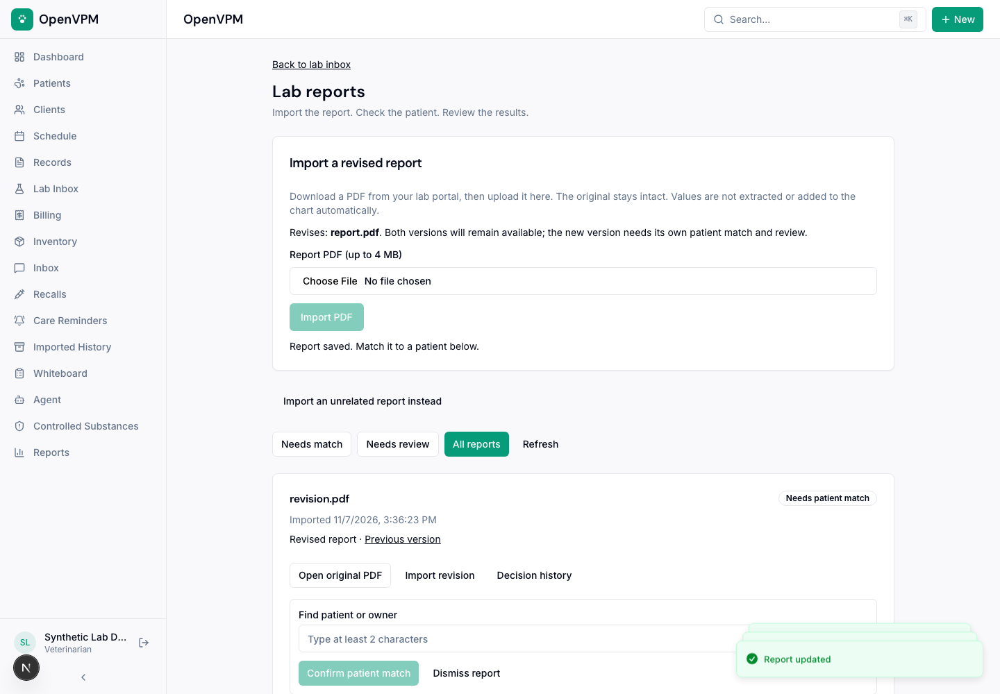
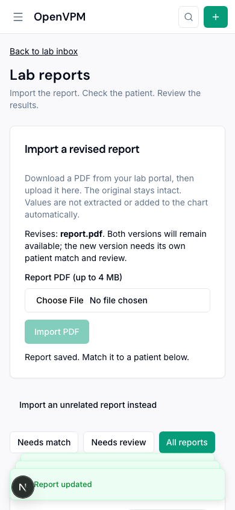

# Importing lab reports

Lab report intake is an opt-in PDF workflow. It does not connect to a lab
provider, send orders, extract values, or populate structured clinical results.
Download the report from the lab's portal first.

## Enable and use

Apply the committed development migrations, including `0100_lab_report_intake`,
and reapply RLS before running this version. Set
`NEXT_PUBLIC_LAB_REPORT_INTAKE_ENABLED=true` and rebuild the web app. The flag is
false by default. Deployments from a different migration lineage must reconcile
that history through the normal release process; do not copy this migration's
journal entry into a different branch.

Open **Lab Inbox → Import and review lab PDFs**:

1. Upload the original PDF (maximum 4 MB). A server-computed SHA-256 checksum
   deduplicates identical bytes within the clinic, including simultaneous imports.
2. Open the original document. Search for the patient or owner and check both
   against the report before confirming the match.
3. A veterinarian or administrator reviews the matched document. Record any
   structured results and follow-up separately through the clinical workflow.
   Reviewing a PDF does not complete an order or close follow-up tasks.

Technicians can import and match reports. Viewers can read them. Front-desk
accounts cannot access this intake or its original lab PDFs. The existing hosted
subscription and recovery-hold write restrictions apply. Current membership and
role are checked at the server, including original-file downloads.

Patient **Documents → View imported lab reports** opens that patient's current
matches. The clinic inbox has separate needs-match, needs-review and all-report
views. All reports includes dismissed documents and earlier versions.

## Corrections, revisions and retries

Use **Correct patient match** to remove an incorrect match with a reason. This
also clears the current review status. Rematch and review again; earlier decisions
remain in history. Dismissal requires a reason and can be reopened.

Use **Import revision** on the earlier report to link a different PDF. Both files
remain available and the new report starts unmatched and unreviewed. A revision
link is supplied by the importing staff member, not inferred from filenames or
report contents. It is not proof of provider authenticity. Identical bytes cannot
be imported as their own revision.

Retry an interrupted upload using **Retry import**. The attempt retains its
idempotency key. Provider writes are read back and verified before creating a
receipt. A failed or ambiguous write cannot create a reviewable report. Separate
uploads of identical bytes converge on one receipt; their managed storage
reservations may still be retained for recovery. They are not automatically deleted.

Each decision also has an idempotency key and expected version. Concurrent changes
cannot silently replace one another. An old exact retry acknowledges the original
decision without restoring an obsolete match or review.

## Storage and recovery

Originals use the private managed-file path and existing replication/reconciliation
machinery. A receipt references the verified file; it never rewrites the file's
patient identity. Receipts and decisions are append-only, tenant-scoped, and use
composite foreign keys. The immutable-history maintenance exception is the same
explicit owner-only `app.ledger_maintenance` procedure as other clinical ledgers.

Practice exports contain `labReportReceipts`, `labReportDecisions`, original file
manifests, referenced patients and staff. Restore orders revision receipts by their
predecessor links and keeps the practice on recovery hold. Attachment-bearing backups can only restore to the original practice identity.
Attachment bytes still
require the existing object-storage recovery process; JSON alone is not a copy of
the PDFs. Older backups without these additive sections remain supported.

Disabling the flag hides the pilot interface and blocks its routes; it does not
delete receipts, decisions, files, or export support. Retain the migration on
rollback. Do not drop the new tables or remove original files.

## Verification

Run the regular type check, unit tests and production build. The CI Golden clinic
job also runs `server/__tests__/lab-report-intake.integration.test.ts` with
`LAB_REPORT_DB_INTEGRATION=1`. It provisions and drops only disposable local
PostgreSQL databases and uses the restricted application role. The test covers
concurrent deduplication and matching, cross-clinic denial, role changes, review,
correction history, revision links, immutable storage records and export/restore.

## Interface examples

These screenshots use fictional patients and reports.

