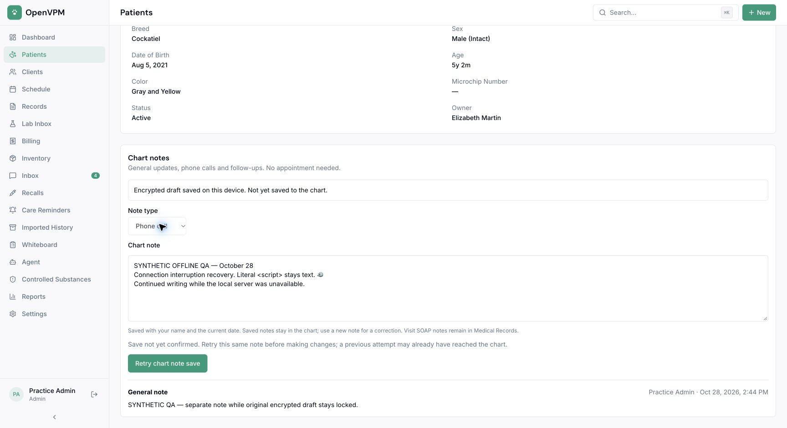

# Chart-note draft recovery

This optional feature keeps an encrypted draft of a standalone patient chart
note on a trusted browser. Open a chart while connected, enable draft recovery,
and choose a separate passphrase of at least 12 characters. Continue writing in
that open chart during a connection interruption. Reopen the same chart as the
same user and enter the passphrase to recover the draft. Save to the chart after
reconnecting; device copies are removed only after the server acknowledges save.

An unconfirmed save locks the text and retains the same operation ID for an
explicit retry. Server authorization and idempotency checks still apply. There
is no automatic clinical submission on reconnect. If another tab changed the
device copy, writing stops rather than overwriting it.

## Pilot configuration

`NEXT_PUBLIC_OFFLINE_CHART_DRAFTS_ENABLED=true` enables the opt-in controls at
build time. The default is `false`. The maintainer owns activation and removal
of this pilot flag. Review its continued need by 2026-11-28; remove it only after
the acceptance cases below pass on the browsers the practice uses.

Start in an isolated environment with synthetic records and outbound providers
disabled. Validate interrupted saves, restored retry identities, wrong-password
recovery, two-tab conflicts, storage denial, and sign-out/account switching.
Obtain clinic agreement on trusted-device use and passphrase retention before
enabling for a production pilot. Disabling the flag stops recovery controls; it
does not erase existing encrypted copies. Re-enable on a compatible build to
recover them before retiring the feature.

## Data handling

IndexedDB holds only versioned AES-256-GCM ciphertext, a random salt and nonce,
a revision identifier, and a SHA-256 digest of practice/user/patient scope.
The scope digest is authenticated additional data. Note text, type, and retry
operation ID are inside the ciphertext. PBKDF2-SHA-256 with 600,000 iterations
derives a non-extractable key from the passphrase. Neither the key nor passphrase
is persisted. Leaving the component or switching account/permission context
drops the in-memory key. Encryption does not protect an unlocked page from
malicious same-origin code or someone controlling the device.

If the passphrase is unavailable, choose **Start a separate note** to continue
ordinary chart work without device recovery. The earlier encrypted copy stays
untouched; reopening the chart offers recovery again.

Browser storage can be denied, cleared or evicted. The UI reports completion
only after the write transaction commits, preserves navigation warnings, and
does not describe the local copy as a clinical record or backup. Passphrases
cannot be reset; keep them securely. No clinical text is added to telemetry or
logs. The device copy is retained until acknowledged chart save or the user
clears this site's browser data.

## Scope

This feature is offline drafting in an already-open chart with encrypted recovery.
Opening the app or a different chart still requires connectivity. It does not
cache patient records, attachments, routes, billing, or the authenticated app
shell. Clinical author/date attribution
continues to describe server save time. Full disconnected navigation and a
multi-record sync queue are outside this feature. The separate, default-off
[offline workspace](offline-workspace.md) supports reopening selected chart
snapshots and recovering SOAP drafts after a server interruption.
