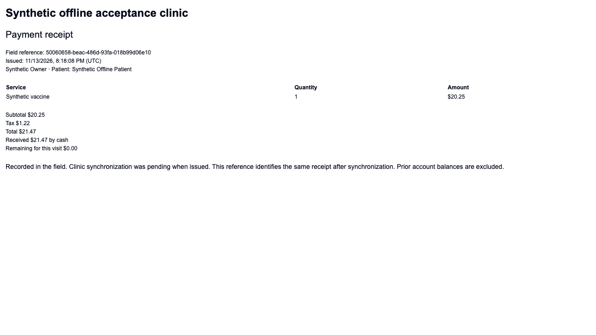

# Offline field visits pilot

The field workspace lets a veterinarian prepare existing patients while online,
then start a visit, record notes and vaccinations, add service charges, record
cash or check payments, and print an itemized bill or receipt without internet.
Reconnect to synchronize the visit and review and sign its clinical note online.

## Supported configuration

The pilot supports US practices billing in USD and a veterinarian with clinic
administrator access. Enable `AMBULATORY_WORKSPACE_ENABLED=true`, the practice's
ambulatory workspace setting, and `OFFLINE_FIELD_VISITS_ENABLED=true` after
acceptance testing. The last flag defaults to false. The sidebar then exposes
**Offline Field Visits** at `/offline/field.html`.

Use HTTPS, a trusted device, and the same browser profile throughout the day.
Prepare up to 20 existing patients or assigned, unstarted appointments before
leaving connectivity. Each preparation is valid for 24 hours. Browser storage
capacity can impose a lower limit for large charts. The workspace reserves room
for issued receipts before accepting additional text or patients.

Preparation contains patient and client details, recorded allergies, medications
marked active, recent vaccinations, recent finalized SOAP notes and chart notes,
and the clinic's service prices and tax settings. This is a dated snapshot, not
a live chart. It is not the full medical archive. Records marked entered in error
are excluded from clinical history. Large safety lists fail preparation rather
than silently dropping entries.

## A field visit

1. Sign in online, create or unlock the field workspace, and prepare patients or
   individual appointments. Verify that the expected patient is listed before
   disconnecting. Bookmark `/offline/field.html`.
2. Start the visit when it occurs. Enter the clinical note and service charges.
   Record vaccine name, product, manufacturer, lot, expiration, dose type, rabies
   tag and next due date as applicable. Each vaccine uses a distinct charged
   service in this pilot. Administration time is preserved separately from sync.
3. Record cash or check received, or leave the visit unpaid. Partial payments are
   supported. The bill excludes prior account balances. It does not process cards.
4. Review and issue the receipt. This freezes its contents and saves it encrypted
   on the device. Print or save a PDF using the browser's print dialog. This is
   an itemized financial document, not a signed vaccination certificate.
5. Reconnect, sign in as the same clinician, and select **Synchronize visit**.
   Review and sign the note online. The synchronized visit remains open for that
   clinical completion. Remove a device copy only after successful synchronization.

The printer must work without internet independently of OpenVPM. Browser print
rendering does not certify a particular USB, Bluetooth, Wi-Fi or AirPrint printer.
Test the actual device, browser, printer and connection before a house call.

A synthetic receipt rendered after an offline browser reopening:



## Data safety and recovery

The passphrase encrypts the workspace in IndexedDB; it is not saved or resettable.
Keep the device locked when unattended. Do not use a shared or private-browsing
profile. Download an encrypted backup before a field day and after entering
important unsynchronized work. Keep the passphrase separately. Clearing browser
storage or losing the passphrase can make local work unrecoverable.

A saved backup can be restored into an empty field workspace using its original
passphrase. It retains preparation and receipt identities. It cannot overwrite
an occupied workspace. Concurrent tabs cannot silently overwrite one another.
If saving fails, editing stops: keep the tab open and download its recovery copy.

Offline access expires after the preparation window. Issued receipts remain
recoverable after reconnecting and authenticating; they can synchronize after
expiry. Online recovery unlocks expired work for five minutes at a time. Expired
unissued visits cannot be issued retroactively; preserve their backup and reconcile
with the clinic online. Keep the computer's clock accurate.

Synchronization commits the appointment, draft SOAP note, vaccine records,
reconciled charges, invoice, payment, original receipt and audit record together.
Retrying the same submission returns the original result, including after a lost
response or a restored backup. A changed submission with an already-used identity
is rejected. Clinician authorization is checked again when synchronizing.

Changed appointment versions, prices, tax settings, patient ownership, unavailable
locations and overlapping appointments cause conflicts. A conflict preserves the
issued local receipt and posts none of that visit. Preserve the device backup,
review the conflict online, and retry the same document only after resolving it.
If a separate online financial correction is needed, retain the original field
reference and verify whether it has already synchronized before entering money
again. The pilot does not provide automated conflict reconciliation.

## Limits and rollout

New clients/patients, inventory products, dispensing/prescriptions, external labs,
card processing, messaging, signatures and certificate generation remain online.
There is no background synchronization while the browser is closed. Users must
prepare again for the next day. A full locally installed clinic server is not
part of this browser pilot.

Before enabling a clinic, the release maintainer must verify migrations and RLS,
backup/restore, browser offline reopening, receipt printing, interrupted-sync
recovery, concurrent retries and the clinic's actual hardware. This is an
expand-only migration: preserve `offline_field_batches` and its original receipts.
Do not roll back to a version without the sync endpoint while devices hold issued
receipts. Disable new preparation with `OFFLINE_FIELD_VISITS_ENABLED=false` first;
this leaves synchronization available. Keep ambulatory billing enabled until
outstanding field work is reconciled.

The automated drills use disposable PostgreSQL and synthetic records:

```sh
pnpm type-check
pnpm test
pnpm build
OFFLINE_WORKSPACE_DB_INTEGRATION=1 pnpm --filter @openpims/web exec vitest run server/__tests__/offline-field.integration.test.ts
OFFLINE_E2E_SERVER_MODE=production pnpm exec playwright test --config=playwright.offline.config.ts
```

Database drills require local owner credentials and `OPENPIMS_APP_DB_PASSWORD`.
Browser drills use `OFFLINE_E2E_ADMIN_DATABASE_URL`, refuse local environment files,
and create and remove their own database. They never seed or reset the supplied
database. Stop the development server before building.
