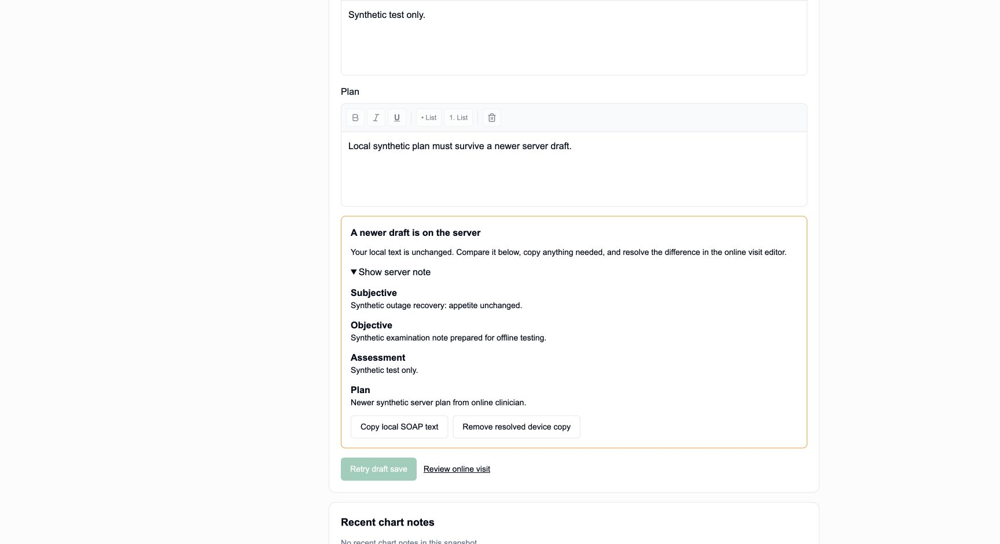

# Offline charts and visit notes

The optional offline workspace lets a veterinarian or administrator prepare
selected charts while connected, reopen them without the server, and continue
writing SOAP visit notes. It uses the same rich-text editor as the online visit.

## Prepare and use a workspace

1. On a trusted device, open a patient chart or an in-exam visit's SOAP editor
   and choose **Make available offline**.
2. Choose a separate workspace passphrase of at least 12 characters. Keep it
   safe: it cannot be reset. The workspace belongs to the signed-in person and
   practice; another account cannot prepare or submit its notes.
3. Choose **Prepare selected chart** and wait for confirmation.
   Bookmark `/offline/index.html`. A workspace holds up to 20 selected charts
   or visits; each shows its snapshot time.
4. During an outage, reopen that bookmark and unlock with the passphrase.
   Visit edits are encrypted and saved to this browser after typing stops.
   Wait for **Encrypted device copy saved** before closing the page.
5. Reconnect and sign in as the same person. Choose **Save draft online** for
   each edited visit. Review and sign in the online visit editor afterward.

There is no automatic submission on reconnect. If a response is lost, the
pending request is retained and editing pauses until **Retry draft save**
confirms its outcome. Retries do not create duplicate notes. If someone changes
or signs the server note, both versions remain available for comparison; the
workspace never silently replaces the newer version. Copy the local text and
review it online before explicitly removing a resolved device copy.

**Lock workspace** drops the in-memory key and hides saved charts. Reopening
requires the passphrase. Offline access lasts up to 24 hours after online
authorization; reconnect and sign in to renew it. Expiry locks the workspace
without deleting its encrypted drafts. Keep the device clock accurate.

## Snapshot scope

Each snapshot includes patient basics, all active recorded allergies (up to
50), the latest 20 explicit chart notes, and up to five active signed SOAP
notes. A chart exceeding the allergy limit cannot be prepared; allergies are
never silently truncated. Private legacy notes are excluded. An in-exam visit
can additionally carry its current SOAP draft for editing.

Snapshots are dated copies, not live records. Later changes are visible only
after refreshing while connected. Medication lists, attachments, lab results,
billing, new visits, and signing are not part of this workspace. Existing
local edits must be saved or resolved before refreshing their snapshot.

## Pilot configuration and rollout

Set `NEXT_PUBLIC_OFFLINE_WORKSPACE_ENABLED=true` at build time and keep it set
in the serving environment to expose preparation controls. It defaults to
`false`. The maintainer owns activation and flag removal; review by 2026-11-28.
Remove the flag only after browser acceptance and a governed staging release.
No database migration is required.

Before enabling a clinic pilot, verify on its supported browsers with synthetic
records: cold offline reopening, passphrase recovery, disk/storage failure,
multiple tabs, account switching, lease expiry, lost responses, server conflicts,
signed visits, and denied clinical access. Obtain agreement on trusted-device
use and passphrase retention. Follow the repository's staging and production
release controls; merging this feature does not enable it.

Disabling the flag stops new preparation. Existing encrypted workspaces can
still unlock and submit drafts through the normal authorization checks. Keep
the compatible shell and reconciliation endpoint available until device drafts
are recovered. Do not retire the endpoint, clear browser storage, or roll back
to a build without recovery while unresolved device drafts remain.

## Storage and security boundaries

Only versioned AES-256-GCM ciphertext, salt, nonce, and a revision token are
stored in IndexedDB. The workspace's identity, patient data, draft text, and
pending request are inside the ciphertext. PBKDF2-SHA-256 with 600,000 iterations
derives a non-extractable key; neither the passphrase nor key is persisted.
Compare-and-swap writes reject competing tabs instead of losing another edit.
This format shares the tested vault implementation used by standalone
[chart-note recovery](offline-chart-note-drafts.md), without changing its stored
format or database.

The service worker is scoped to `/offline/` and caches only three generated
public application files. It never caches authenticated pages, API responses,
sessions, patient data, or mutations. Public files are fetched without cookies.
Updates wait for existing workspace tabs to close. Build caches include those
generated files so restored builds retain their offline shell.
The build hash also includes local environment files and both offline rollout
flags, preventing a cached build from retaining an earlier flag setting.

Every preparation and save rechecks current user membership and clinical role,
tenant RLS, and recovery holds. Saves also enforce hosted subscription access,
the original note revision, and the existing SOAP lifecycle. A content-free
audit commits in the same transaction; an audit failure rolls back the note.
No clinical text is added to logs or telemetry by this feature.

Offline revocation is bounded by the local 24-hour lease: a disconnected device
cannot learn immediately about server permission changes. Encryption does not
protect an unlocked page from malicious same-origin code or someone controlling
the device or its clock. Browser storage can be cleared, denied, or evicted;
device copies are not a backup or a signed clinical record. Lost passphrases
and cleared device data cannot be recovered by the server.

## Verification

Run the ordinary type check, test suite, and build. The Golden clinic CI job
also runs `offline-workspace.integration.test.ts` against a disposable local
PostgreSQL database under the restricted application role. It verifies tenant
and role isolation, concurrent saves, idempotent retries, newer drafts, signed
visits, account revocation, recovery holds, and atomic audit failure. Unit tests
cover encryption compatibility, workspace transitions, leases, conflicting
browser writes, and the service worker's exact public-file cache boundary.
